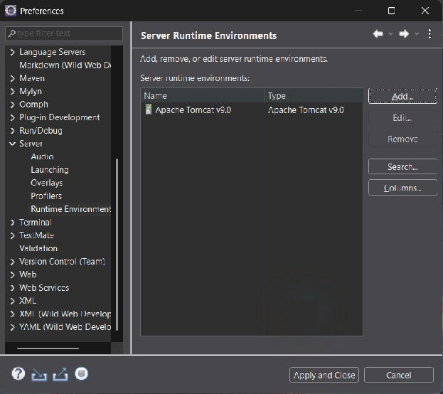
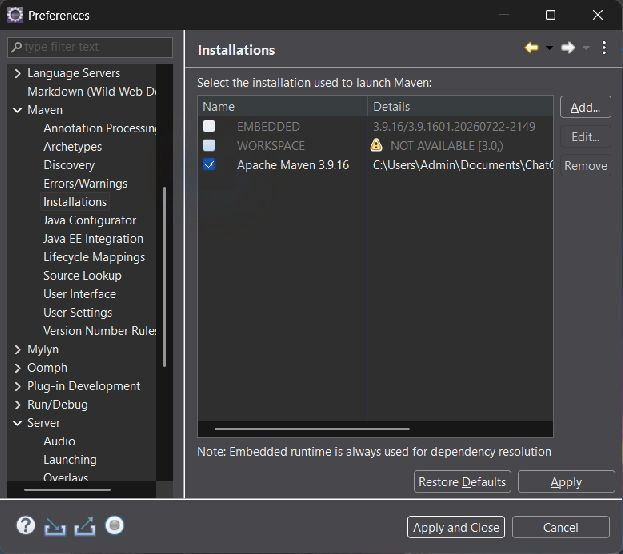
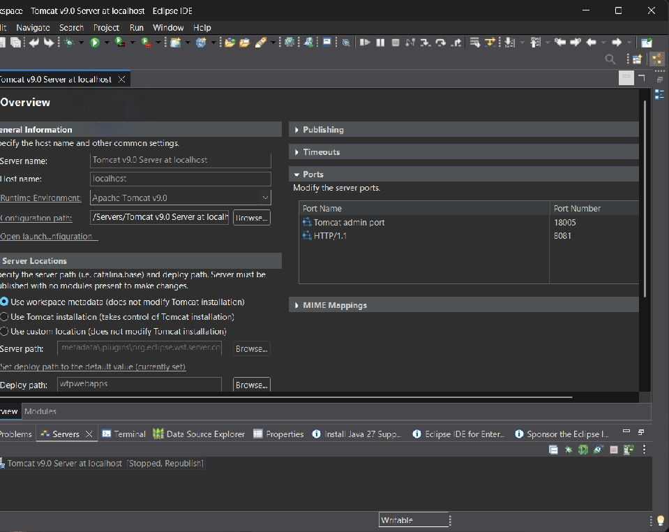
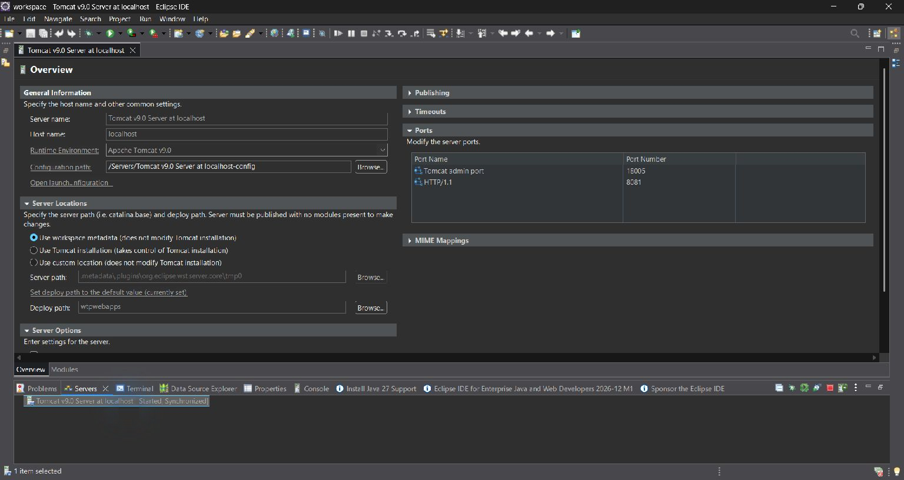
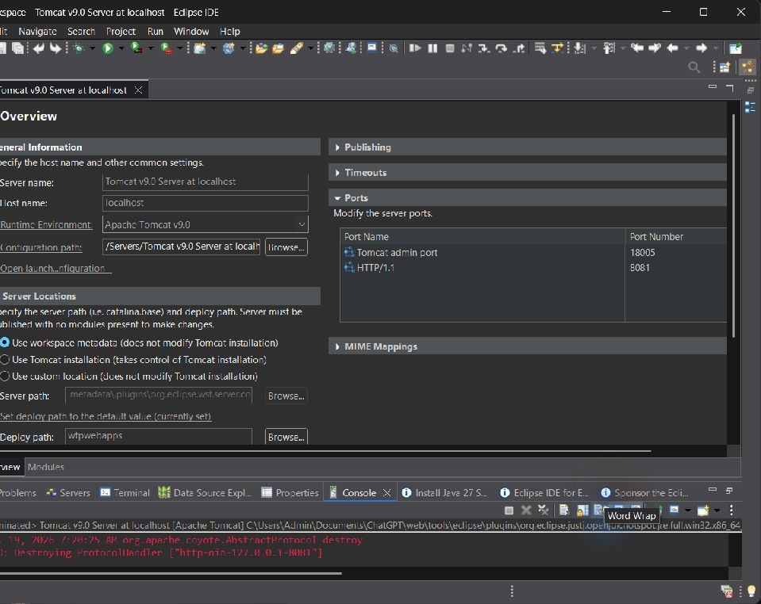

# Лабораторная работа № 1

## Установка и настройка среды разработки и исполнения web-приложения

**Цель:** изучить настройку Apache Tomcat и системы сборки Maven в Eclipse.

## Среда

| Компонент | Версия |
|---|---|
| ОС | Windows 11, x86_64 |
| Eclipse IDE for Enterprise Java and Web Developers | 2026-09 (4.41) |
| Java с компилятором javac, из комплекта Eclipse | OpenJDK 25.0.4.1 |
| Apache Tomcat | 9.0.123 |
| Apache Maven | 3.9.16 |

Инструменты распакованы в каталог `tools`, рабочая область Eclipse — `workspace`.

## Ход выполнения

1. Загружены и распакованы Eclipse, Tomcat и Maven с официальных сайтов.
2. Проверены Java и Maven командой `mvn -v`. Вывод сохранён в [maven-version.txt](maven-version.txt).
3. В HTTP Connector файла `conf/server.xml` добавлен `useBodyEncodingForURI="true"`. Для повседневной работы выбран HTTP-порт 8081 и адрес 127.0.0.1, порт остановки — 18005.
4. Tomcat запущен отдельно. Получена стандартная стартовая страница: HTTP 200 на порту 8081.
5. Порт 8080 на IPv4 занят другим приложением. Для проверки стандартного порта использован IPv6 loopback `http://[::1]:8080/`: HTTP 200, стандартная страница Apache Tomcat/9.0.123. Дополнительный экземпляр после проверки остановлен. Конфигурация этого опыта сохранена отдельно в `server-8080-ipv6.xml`; основная конфигурация восстановлена на 8081.
6. В Eclipse через Window → Preferences → Server → Runtime Environments добавлен Apache Tomcat v9.0 и создан локальный сервер.
7. В Maven → Installations добавлен внешний Maven 3.9.16 и выбран по умолчанию. Настройки подтверждены сохранёнными preferences Eclipse.
8. В конфигурации запуска Tomcat на вкладке Classpath включён **Use temporary JAR to specify classpath**. Это устранило ошибку `ClassNotFoundException: org.apache.catalina.startup.Bootstrap`.
9. Tomcat запущен из представления Servers в Eclipse. Зафиксировано состояние **Started, Synchronized**. В журнале подтверждён запуск HTTP Connector на 8081.
10. Tomcat остановлен из Eclipse. Журнал подтверждает получение команды shutdown и остановку/уничтожение HTTP Connector.

В режиме рабочего пространства Eclipse корневое приложение из установленного Tomcat автоматически не развёрнуто: запрос `/` возвращал HTTP 404 с подписью Apache Tomcat/9.0.123. Это зафиксировано отдельно от успешной проверки стандартной страницы при самостоятельном запуске сервера.

## Конфигурационные файлы

- [server.xml](server.xml) — изменённая основная конфигурация.
- [server-original.xml](server-original.xml) — исходная конфигурация.
- [server-8080-ipv6.xml](server-8080-ipv6.xml) — конфигурация проверки 8080 через IPv6.
- [check-8080.txt](check-8080.txt), [check-8081.txt](check-8081.txt), [check-eclipse.txt](check-eclipse.txt) — результаты HTTP-проверок.

## Скриншоты

### Подключённый Tomcat runtime

### Внешний Maven выбран в Eclipse

### Настройки сервера и портов

### Tomcat запущен из Eclipse: Started, Synchronized

### Остановка Tomcat из Eclipse

## Повторный запуск

Открыть Eclipse: `./Лаба1/start-eclipse.ps1`. В Servers выбрать Tomcat и использовать Start / Stop. Перед запуском из IDE отдельный экземпляр на 8081 должен быть остановлен.

Для работы из PowerShell загрузить среду командой `. ./Лаба1/environment.ps1`. Затем доступны `java`, `javac`, `mvn`. Скрипты `start-tomcat.ps1` и `stop-tomcat.ps1` управляют самостоятельным экземпляром.

## Вывод

Среда установлена и настроена. Tomcat проверен на портах 8080 (IPv6) и 8081 (IPv4); внешний Maven подключён к Eclipse; запуск и остановка Tomcat выполнены из IDE. Конфигурации и результаты проверок сохранены.
